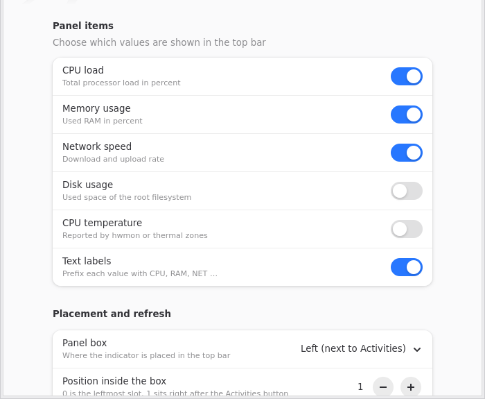

# Panel Stats

Расширение GNOME Shell: показывает загрузку CPU, памяти, скорость сети (а по желанию — диск и
температуру) **слева в верхней панели**, рядом с кнопкой «Обзор» / «Показать все окна».
По клику открывается меню с подробностями.



## Установка одной командой

```bash
curl -fsSL https://raw.githubusercontent.com/st2l/gnome-panel-stats/main/install.sh | bash
```

Скрипт скачивает расширение, кладёт его в `~/.local/share/gnome-shell/extensions/`, компилирует
схему GSettings и включает расширение. Индикатор появляется сразу, перезагрузка сессии не нужна.

### Из клона репозитория

```bash
git clone https://github.com/st2l/gnome-panel-stats.git
cd gnome-panel-stats
./install.sh
```

### Из zip-релиза

```bash
gnome-extensions install --force panel-stats@st2l.github.io.shell-extension.zip
gnome-extensions enable panel-stats@st2l.github.io
```

## Что показывает

В панели (каждый пункт включается отдельно):

| Пункт | Пример | По умолчанию |
|-------|--------|--------------|
| CPU   | `CPU 12%` | включён |
| Память | `RAM 33%` | включён |
| Сеть | `NET ↓1.2M ↑48K` | включён |
| Диск | `DISK 90%` | выключен |
| Температура CPU | `TEMP 45°C` | выключен |

В меню по клику:

- **Процессор** — общая загрузка, температура, load average, аптайм, число процессов и загрузка
  каждого ядра отдельно;
- **Память** — использовано / всего, доступно, кэш, swap;
- **Сеть** — суммарная скорость и трафик, затем каждый интерфейс отдельно (включая VPN-туннели);
- **Диск** — занято на корневой ФС, свободно, скорость чтения/записи и каждое устройство отдельно.

Суммарная скорость сети считается только по физическим интерфейсам (`/sys/class/net/*/device`),
поэтому трафик VPN не учитывается дважды.

## Настройки

```bash
gnome-extensions prefs panel-stats@st2l.github.io
```

или пункт «Settings» в меню индикатора. Настраивается набор пунктов, подписи (`CPU`, `RAM`, …),
интервал обновления (0.5–30 с), часть панели (слева / по центру / справа) и позиция внутри неё
(`1` — сразу после кнопки «Обзор», `0` — перед ней).

## Совместимость

- GNOME Shell 48, 49, 50, 51 — Wayland и X11.
- Без зависимостей: никакого libgtop, данные читаются из `/proc/stat`, `/proc/meminfo`,
  `/proc/net/dev`, `/proc/diskstats`, `/proc/loadavg`, `/proc/uptime` и `/sys/class/hwmon`.

## Удаление

```bash
make uninstall
# или
gnome-extensions disable panel-stats@st2l.github.io
rm -rf ~/.local/share/gnome-shell/extensions/panel-stats@st2l.github.io
```

## Разработка

```bash
make install   # установить из рабочей копии
make pack      # собрать panel-stats@st2l.github.io.shell-extension.zip
make prefs     # открыть окно настроек
make logs      # смотреть лог GNOME Shell
```

Структура: `extension.js` — индикатор в панели, `menu.js` — выпадающее меню,
`stats.js` — чтение `/proc` и `/sys`, `prefs.js` — окно настроек,
`schemas/` — схема GSettings.

## Лицензия

GPL-3.0-or-later.
